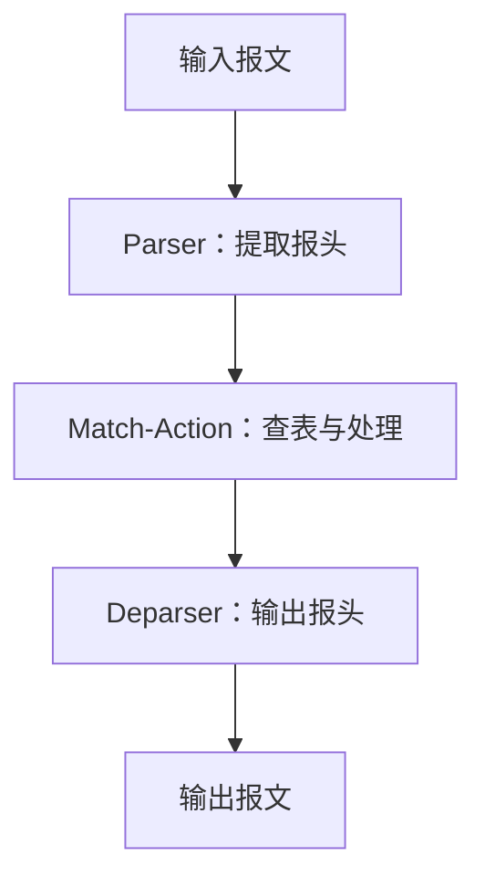
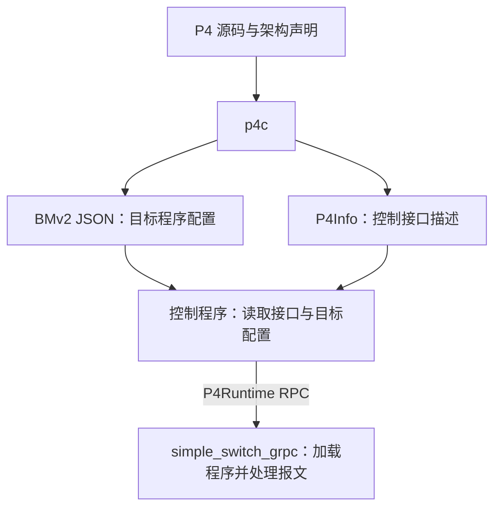

# 02 · P4 概述与核心概念

本章介绍 P4 描述什么、程序怎样在目标上运行，以及数据平面与控制平面如何分工。语言概念以 P4<sub>16</sub> 规范 v1.2.5 为依据。

## 2.1 P4 是什么

P4 的全称是 **Programming Protocol-independent Packet Processors**。它是一门面向报文处理的领域特定语言，用来描述网络设备的数据平面行为，例如提取报头字段、查表、修改报头，以及选择转发或丢弃。执行 P4 程序的目标可以是硬件，也可以是软件。

以 IPv4 转发为例，P4 程序可以规定：解析目的地址，用它查询路由表，命中后修改目的 MAC 地址、递减 TTL，并设置出端口。至于路由如何计算、何时更新，由控制平面负责。

本教程用 BMv2 软件交换机运行 P4 程序，通过抓包和表项读回观察这些行为。

## 2.2 为什么需要数据平面编程

固定功能交换机通常已经确定了可解析的协议、匹配字段和动作集合。控制平面在这些功能中配置转发规则，例如增加一条路由。

OpenFlow 提供了控制交换机的标准接口，其各版本规定了可匹配的字段和可执行的动作。要让设备识别新的报头，还需要能够定义报头格式及其处理逻辑。

P4 将报头格式、解析过程和匹配动作逻辑纳入程序描述，使程序员能够在目标支持的范围内定义数据平面。2014 年的 [P4 论文](https://doi.org/10.1145/2656877.2656890)讨论了这一动机：P4 定义数据平面如何处理报文，OpenFlow 等控制协议负责控制器与设备之间的交互。

## 2.3 三个设计目标

P4 最初提出了协议无关、目标无关和部署后可重配置三个目标。

### 协议无关

程序通过报头类型和解析逻辑描述要处理的字段，语言不内置一套固定的网络协议集合。例如，以太网地址和 IPv4 地址的名称、位宽及提取顺序都可以在源码中定义。

目标支持的解析深度、字段宽度和运算类型，决定了这些定义能够怎样实现。

### 目标无关

P4 提供独立于具体设备指令集的表达方式，由编译器完成映射。程序仍然依赖所选架构的接口，例如元数据、可编程块的参数和外部功能。

迁移到另一架构时，需要适配可编程块和元数据等接口。选择同一架构的其他目标实现时，也需核对其操作支持与资源容量。

### 部署后可重配置

支持重配置的目标可以加载新的数据平面程序。这里应区分两类修改：

| 修改                           | 通常涉及的操作                     |
| ------------------------------ | ---------------------------------- |
| 为已有 IPv4 路由表增加下一跳   | 控制平面更新表项，无须改变程序结构 |
| 增加此前未定义的报头及处理逻辑 | 修改 P4 源码，重新编译并部署       |

重新部署时，转发中断时间及表项、有状态对象的保留方式取决于目标和部署方法。具体的流水线配置操作见 [15.2.2 节](./15-P4Runtime控制平面.md#1522-forwardingpipelineconfig)。

## 2.4 PISA、架构与目标

**PISA**（Protocol-Independent Switch Architecture，协议无关交换架构）是一种理解可编程交换机的常见模型。其主要可编程部分可概括为下面的逻辑流程：



图中展示解析、匹配动作处理和反解析三个可编程部分。缓存、队列和调度等功能由具体架构与目标安排，相关接口及语义见 [10.2 节](./10-架构与包.md#102-架构描述包含什么)。

P4<sub>16</sub> 可以面向交换机、网卡和软件报文处理系统等目标。阅读程序时，可以按以下层次理解各部分的职责：

| 层次         | 回答的问题                             | 本教程中的例子       |
| ------------ | -------------------------------------- | -------------------- |
| 语言         | 可以声明哪些类型，语句如何执行         | P4<sub>16</sub>      |
| 架构         | 有哪些可编程块，它们如何与目标交换数据 | V1Model              |
| 目标实现     | 谁执行程序，支持哪些操作与资源         | BMv2 `simple_switch` |
| 编译器及后端 | 怎样把程序映射到目标                   | p4c 的 BMv2 后端     |

PISA 描述一类可编程交换机的组织方式，V1Model、PSA 等 P4 架构规定程序与目标之间的具体接口和行为。架构与目标的关系将在 [第 10 章](./10-架构与包.md)进一步展开。

## 2.5 一份程序由什么组成

下面按 V1Model 示例说明各部分的职责。程序根据处理任务选择需要的功能，例如第 3 章的 Hello P4 只设置出端口，将未解析的报文原样发回。

| 组成部分   | 用途                                                                 |
| ---------- | -------------------------------------------------------------------- |
| 类型声明   | 描述报头字段，以及程序中使用的元数据                                 |
| `parser`   | 用状态机描述字段提取和解析分支                                       |
| `control`  | 描述数据平面的处理顺序、条件分支和调用                               |
| `action`   | 封装报头、元数据等数据的处理操作                                     |
| `table`    | 根据键查询表项，选择动作及其参数                                     |
| Deparser   | 在本教程的架构中，由调用 `packet_out.emit` 的 `control` 实现报头输出 |
| 顶层包实例 | 将可编程块装配到架构接口上，如 `V1Switch(...) main`                  |

例如，下面的控制块取自 [Hello P4](../examples/01-hello/hello.p4)，其作用是把出端口设为入端口：

```p4
control MyIngress(inout headers hdr,
                  inout metadata meta,
                  inout standard_metadata_t std_meta) {
    apply {
        std_meta.egress_spec = std_meta.ingress_port;
    }
}
```

该片段与源码中的类型声明和架构定义一起编译。`standard_metadata_t` 和其中的端口字段来自 V1Model，`control`、`apply` 与赋值语句属于 P4 语言。

这里的 `control` 是**数据平面控制块**，负责当前报文的处理。控制平面程序负责计算路由、下发表项等配置工作。

## 2.6 P4<sub>14</sub> 与 P4<sub>16</sub>

本教程使用 P4<sub>16</sub>。阅读旧资料时，先确认其语言版本：

| 语言版本        | 与本教程关系较大的区别                                       |
| --------------- | ------------------------------------------------------------ |
| P4<sub>14</sub> | 语言包含较多交换机模型的约定，以及计数器、寄存器等专用构造   |
| P4<sub>16</sub> | 将具体架构从语言中分离，以类型、包和 `extern` 等机制表达接口 |

P4<sub>16</sub> 的第一版正式规范于 2017 年发布。“P4<sub>16</sub>”是语言版本名称，`1.2.5` 是该语言规范的修订号，`p4c --version` 输出的则是编译器版本。

p4c 提供从 P4<sub>14</sub> 转换到 P4<sub>16</sub> 的工具，见 [p4c 的转换用法](https://github.com/p4lang/p4c/blob/8b6de3c579e717ee278c38041b868e9ef2345f5f/README.md#sample-backends-in-p4c)。迁移时还需检查转换结果的架构依赖，并验证报文处理行为。

## 2.7 数据平面与控制平面怎样配合

在本教程的 P4Runtime 实验中，源码、编译产物与控制程序的关系如下：



控制程序读取同一次编译生成的 P4Info 和 BMv2 JSON，与服务端完成主控仲裁后，安装流水线配置，再下发表项。

**P4Info** 描述控制平面可访问的表、动作及其他实体，包含对象名称、标识符、匹配字段和动作参数。动态表项由控制程序通过读写请求管理。

**P4Runtime** 是基于 gRPC 的标准控制接口，用于流水线配置、表项及相关资源的读写，以及报文收发。本教程采用 P4Runtime 规范 v1.4.1，具体接口和实验方法见[第 15 章](./15-P4Runtime控制平面.md)。

本仓库编号示例 02～05 默认使用 `simple_switch_CLI`，通过 Thrift 配置 `simple_switch`。示例 01 无需表项配置，示例 05 另提供 P4Runtime 方式，两种 BMv2 进程的用途见 [14.1 节](./14-BMv2编译与运行.md#141-工具链与编译产物)。

设备管理还有其他接口：gNMI 用于配置、状态查询与遥测，gNOI 用于重启等运维操作，它们均通过 gRPC 组织远程调用。相关职责见 [OpenConfig RPC 说明](https://openconfig.net/rpc/)。

## 2.8 从路由表示例理解分工

假设数据平面已经定义了一张以 IPv4 目的地址做最长前缀匹配的表，并提供“设置下一跳与出端口”的动作：

1. P4 程序规定匹配字段、匹配方式和可选动作。
2. 控制平面根据路由计算或静态配置，写入“`10.0.2.0/24` 对应下一跳与端口”的表项。
3. 报文到达后，数据平面解析地址、查表并执行动作，无须每个报文都先交给控制平面决策。

如果只改变这个网段的下一跳，通常更新表项即可。如果希望按另一个报头字段匹配，则先检查现有解析逻辑与表是否支持，必要时修改程序并重新编译部署。

表项也可以通过 `const entries` 直接写入 P4 源码，随程序固定下来。表项的初始化与可修改性见 [第 8 章](./08-匹配动作表.md)。

## 2.9 程序的执行与状态

### 循环与递归

P4<sub>16</sub> v1.2.5 允许解析器通过状态环重复处理，例如逐个提取报头栈中的元素，具体写法见 [6.10 节](./06-Parser解析器.md#610-报头栈解析)。解析深度和循环实现受目标约束。语言禁止直接或间接递归调用。

该版本没有定义通用 `for` 语句。本机 p4c `1.2.5.10` 的前端接受这一扩展：一个迭代两次的 `for` 示例通过 `p4test`，但 BMv2 后端在默认选项下报 `BMV2 does not support loops`。两元素报头栈的解析器环则通过 BMv2 编译。

### 类型与状态

报头字段常用显式位宽的整数表示，P4 还提供布尔、枚举、结构体等类型。各类值的表示与操作见[第 5 章](./05-类型系统.md)。

元数据在当前报文的处理阶段之间传递信息。跨报文保存的计数或状态通常通过架构提供的 `extern` 对象访问，例如 V1Model 的寄存器、计数器和计量器。对象的接口与并发语义见[第 12 章](./12-外部对象Extern.md)。

### 处理路径与资源

架构与目标安排报文的丢弃、复制和再次处理路径。例如，重提交或重循环可以让报文重新进入 Parser，V1Model 的用法见 [11.5.7 节](./11-V1Model架构.md#1157-重提交与重循环)。

开发时先核对目标支持的类型、操作和资源容量，再通过编译、表项读回与测试报文检查程序。

## 2.10 本章小结

- P4 描述数据平面的报文处理行为，控制平面负责计算策略并配置相应对象。
- 架构定义接口，目标实现提供能力，编译器完成映射。跨目标迁移需要核对这三者。
- PISA 描述一类可编程交换机的组织方式，V1Model、PSA 等架构规定具体接口与行为。
- 修改表项通过控制接口完成，替换程序需要重新编译部署。
- 使用某项语言特性前，应确认规范版本和目标编译器的支持情况。

## 2.11 下一步

进入 [03 · 第一个 P4 程序](./03-第一个P4程序.md)，结合 Hello P4 观察程序结构和报文路径。语法细节从 [第 4 章](./04-语法基础.md)开始介绍。
