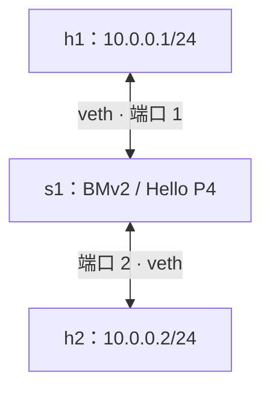

# 03 · 第一个 P4 程序：Hello P4

本章在 BMv2 `simple_switch` 上运行一个报文反射程序：从端口 1 收到的报文仍从端口 1 发出，端口 2 同理。通过源码讲解、自动验证和手工抓包，可以观察一帧报文从接收到发送的处理过程，认识 V1Model 的程序结构。

## 3.1 实验拓扑



`run.sh` 创建两个独立的 Linux 网络命名空间，分别通过 veth 链路将主机连接到 BMv2。

图中的 `h1`、`h2` 是逻辑名称。实际命名空间和交换机侧接口名由脚本在每次运行时生成，主机内的接口均为 `eth0`。

## 3.2 程序结构

完整源码见 [hello.p4](../examples/01-hello/hello.p4)。下面各段按顺序拼接，可组成完整程序。六个可编程块及其参数由 V1Model 规定，接口对照见 [11.3 节](./11-V1Model架构.md#113-六个块的接口)。

### 3.2.1 引入声明并定义类型

```p4
#include <core.p4>
#include <v1model.p4>

struct headers  { }
struct metadata { }
```

`core.p4` 声明 `packet_in`、`packet_out` 等核心接口。`v1model.p4` 声明 `standard_metadata_t` 和 `V1Switch` 等架构接口。

`headers` 与 `metadata` 都是用户定义的类型。本例通过标准元数据选择端口，将这两个类型定义为空结构体，作为架构接口的参数传递。

### 3.2.2 Parser

```p4
parser MyParser(packet_in packet,
                out headers hdr,
                inout metadata meta,
                inout standard_metadata_t std_meta) {
    state start {
        transition accept;
    }
}
```

解析器从 `start` 直接转移到 `accept`，成功结束解析，所有输入字节均保留为未解析负载。出端口由后续的 Ingress 选择。

### 3.2.3 VerifyChecksum

```p4
control MyVerifyChecksum(inout headers hdr, inout metadata meta) {
    apply { }
}
```

本例将架构要求的校验和验证块留空，报文直接进入 Ingress。

### 3.2.4 Ingress

```p4
control MyIngress(inout headers hdr,
                  inout metadata meta,
                  inout standard_metadata_t std_meta) {
    apply {
        std_meta.egress_spec = std_meta.ingress_port;
    }
}
```

本例的出端口选择由这一条赋值完成。BMv2 在收到报文时设置 `ingress_port`，程序把它赋给 `egress_spec`，选择同一个端口作为单播出端口。字段含义见 [11.4 节的标准元数据表](./11-V1Model架构.md#114-standard_metadata_t-速查)。

例如，启动参数 `-i 1@某接口` 将该接口绑定为 BMv2 端口 1。从它进入的普通报文，其 `ingress_port` 为 1，执行本例后 `egress_spec` 也为 1。端口号来自 BMv2 的接口绑定，不是 Linux 的接口索引。

这里的 `std_meta` 是参数名，`standard_metadata_t` 是参数类型。

### 3.2.5 Egress 与 ComputeChecksum

```p4
control MyEgress(inout headers hdr,
                 inout metadata meta,
                 inout standard_metadata_t std_meta) {
    apply { }
}

control MyComputeChecksum(inout headers hdr, inout metadata meta) {
    apply { }
}
```

这两个控制块的 `apply` 均为空，报文在出方向保持原值。

### 3.2.6 Deparser

```p4
control MyDeparser(packet_out packet, in headers hdr) {
    apply { }
}
```

BMv2 在 Deparser 输出的报头之后接上 Parser 尚未消费的字节。本例的 Parser 保留所有输入字节，Deparser 为空，因此原报文的字节和顺序保持不变。

若后续程序提取了以太网报头，并希望保留它，就需要在 Deparser 中用 `emit` 输出该报头。报头与未解析负载的关系见 [9.1 节](./09-Deparser反解析器.md#91-deparser-的职责)。

### 3.2.7 实例化顶层包

```p4
V1Switch(
    MyParser(),
    MyVerifyChecksum(),
    MyIngress(),
    MyEgress(),
    MyComputeChecksum(),
    MyDeparser()
) main;
```

这段声明创建名为 `main` 的顶层包实例，并按 `V1Switch` 的接口顺序传入六个块。块的参数类型、方向和顺序必须与架构声明兼容。

## 3.3 编译

以下命令均从**仓库根目录**执行，基础工具链参照 [第 1 章](./01-环境搭建.md)。验证程序使用 Python 标准库，要求 Linux Python 3.12 或更高版本，通过 `os.setns` 在主机命名空间中创建抓包套接字。

```bash
bash examples/01-hello/build.sh
```

默认在 `examples/01-hello/` 下生成：

| 文件                 | 用途                                     |
| -------------------- | ---------------------------------------- |
| `hello.json`         | BMv2 加载的目标程序配置                   |
| `hello.p4info.txtpb` | 文本格式 P4Info，供查看控制平面接口       |

本例运行时加载 `hello.json`，端口选择由 Ingress 中的赋值完成。

编译脚本也接受一个可选的输出目录参数，例如：

```bash
bash examples/01-hello/build.sh /tmp/hello-build
```

## 3.4 自动验证报文反射

```bash
sudo bash examples/01-hello/run.sh
```

脚本将当前源码编译到独立临时目录，创建两主机拓扑、启动 BMv2，再调用 [verify.py](../examples/01-hello/verify.py)验证数据平面。BMv2 通过 `-i` 参数绑定两个接口，Thrift 监听端口由系统分配。

验证程序在两台主机的接口上先创建套接字，再依次发出测试帧。每台主机分别发送 60、128、1514 字节的以太帧，长度不含 FCS。测试帧使用广播目的 MAC、实验用 EtherType `0x88b5` 和随机标识，直接通过原始套接字发送。

每次发送都检查：

1. 原主机收到一份与发送内容逐字节一致的帧，本机发包记录不计入结果。
2. 另一主机在观察窗口内没有收到该测试帧。
3. 原主机在观察窗口内没有收到重复副本。

等待反射的超时为 3 秒，收到反射后继续观察 0.3 秒，以检查重复帧或另一端口上的副本。正常输出包含：

```text
PASS：h1，60 字节，反射帧一致；观察窗口内另一主机未收到测试帧
PASS：h1，128 字节，反射帧一致；观察窗口内另一主机未收到测试帧
PASS：h1，1514 字节，反射帧一致；观察窗口内另一主机未收到测试帧
PASS：h2，60 字节，反射帧一致；观察窗口内另一主机未收到测试帧
PASS：h2，128 字节，反射帧一致；观察窗口内另一主机未收到测试帧
PASS：h2，1514 字节，反射帧一致；观察窗口内另一主机未收到测试帧
PASS：两个端口的 Hello P4 反射验证完成
```

默认验证通过后脚本退出，编译、启动或验证失败时返回非零状态。正常结束、报错、SIGINT 或 SIGTERM 都会触发清理，停止本次启动的 BMv2 进程，并删除相应接口、命名空间及临时目录。

## 3.5 保留拓扑并观察 ARP

本节用 ping 触发 ARP 解析，再抓取原路返回的请求帧。在终端一运行：

```bash
sudo bash examples/01-hello/run.sh --keep
```

验证通过后脚本保持运行，并打印本次命名空间名称、抓包命令、ping 命令及日志位置。

在终端二先启动抓包。下面的 `hello-XXXXXX-h1` 必须替换为脚本实际输出的名称，也可以直接复制脚本打印的完整命令：

```bash
h1_ns=hello-XXXXXX-h1
sudo ip netns exec "$h1_ns" tcpdump -Q in -n -e -i eth0 arp
```

在终端三发送 ping，同样替换命名空间名称：

```bash
h1_ns=hello-XXXXXX-h1
sudo ip netns exec "$h1_ns" ping -c 2 -W 1 10.0.0.2
```

此时 h1 需要先获知 `10.0.0.2` 的 MAC 地址，因此发出 ARP 请求。Hello P4 将请求从原端口反射回来，h2 收不到请求，邻居解析无法完成。ping 此时通常还没有发出承载 ICMP 请求的以太帧。

终端二应能捕获返回的 ARP 请求。`-Q in` 只显示接收方向的帧，排除本机发送方向的抓包记录。

手工观察结束后，先停止终端二的抓包命令，再在终端一按 Ctrl+C 结束实验。临时目录会随之删除，需要保存的日志应在退出前复制。

## 3.6 回顾一次处理过程

| 阶段                | 本例中的行为                                    |
| ------------------- | ----------------------------------------------- |
| 接收与 Parser       | BMv2 记录入端口，解析器直接结束，保留全部字节   |
| VerifyChecksum      | 不执行协议校验和验证                            |
| Ingress             | 将 `ingress_port` 赋给 `egress_spec`            |
| BMv2 内部转发与排队 | 根据所选端口将报文送往出方向处理                |
| Egress              | 不修改报文                                      |
| ComputeChecksum     | 不更新协议校验和                                |
| Deparser 与发送     | 不添加报头，保留未解析的字节，并从原端口发出    |

本例用 `std_meta` 传递端口信息，`hdr` 与 `meta` 保持为空。

## 3.7 常见问题

| 现象                         | 检查方法                                                           |
| ---------------------------- | ------------------------------------------------------------------ |
| 找不到 `standard_metadata_t` | 检查是否包含 `v1model.p4`，以及编译器能否找到架构头文件            |
| 顶层包或块的类型检查失败     | 对照 `V1Switch` 检查六个块的签名、顺序和 `main` 实例               |
| 脚本提示缺少 `os.setns`      | 检查 `sudo` 环境实际使用的 `python3` 路径与版本                    |
| BMv2 启动失败                | 查看脚本输出的日志，动态库错误可用 `ldd` 检查缺失的依赖            |
| 接收到报文但验证仍失败       | 检查是否改写了字节、发往另一端口或生成了重复副本                   |
| 只看到 ARP，没看到 ICMP      | 邻居解析尚未完成，参照 3.5 节分析                                  |
| 抓包命令找不到命名空间       | 用 `--keep` 保留拓扑，并从脚本输出中复制本次命名空间名称           |

## 3.8 验证记录

本章在第 1 章记录的 Ubuntu 24.04 / WSL2 环境中，使用 p4c `1.2.5.10`、BMv2 `1.15.0-2bdd0b7b` 和 Python `3.12.3` 验证。正文各段源码拼接后可编译，自动实验检查两个端口与三种帧长。

反例检查使用临时修改的程序：全部丢弃测试帧、把报文转发到另一端口、改写报文字节，均被验证程序判为失败。手工抓包确认了返回的 ARP 请求，编译失败、启动失败、SIGINT 与 SIGTERM 后的资源清理也已检查。

## 3.9 下一步

继续阅读 [04 · 语法基础](./04-语法基础.md)，逐步理解声明、类型与语句。需要学习基于表项的转发时，可查看 [L2 交换机示例](../examples/02-l2-switch/README.md)。
