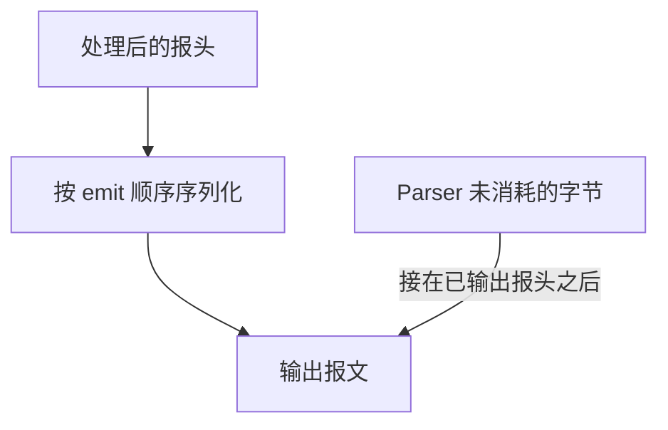

# 09 · Deparser 反解析器

本章介绍 `packet_out.emit` 如何把报头序列化为输出数据，以及它与有效位、未解析负载和校验和的关系。语言规则依据 P4<sub>16</sub> 规范 v1.2.5 第 16 节。本机验证使用 p4c 1.2.5.10 和 `simple_switch` 1.15.0。

前面的代码片段采用 9.6 节中的 Ethernet、VLAN 类型和 V1Model 接口。涉及 IPv4 等其他报头时，另行说明类型和适用范围。

## 9.1 Deparser 的职责

P4<sub>16</sub> 没有专用的 `deparser` 关键字，反解析由带 `packet_out` 参数的控制块完成，具体接口由架构规定。Deparser 按程序指定的顺序输出有效报头。

对于本章的 BMv2 `simple_switch` 普通报文路径，输出由两部分组成：



后半部分是目标保留的未解析负载。已经被 Parser 提取或跳过的字节不再属于这一部分，需要保留的内容应存入报头，并由 Deparser 输出。

## 9.2 一个最小 Deparser

```p4
control MyDeparser(packet_out packet, in headers hdr) {
    apply {
        packet.emit(hdr.ethernet);
        packet.emit(hdr.vlan);
    }
}
```

输出顺序由实际执行的 `emit` 调用顺序决定。对常见的 Ethernet → VLAN → IPv4 → TCP 报文，Parser 从外层到内层提取，Deparser 也按外层到内层输出。

在 V1Model 接口中，`hdr` 的方向为 `in`，Deparser 不能通过它改写字段或有效位。应在之前的 Ingress、Egress 或相应校验和块完成修改。

## 9.3 `packet_out.emit` 的语义

`core.p4` 中的 `packet_out` 接口如下：

```p4
extern packet_out {
    void emit<T>(in T hdr);
}
```

本章使用以下四类对象：

| 对象           | 输出规则                                                     |
| -------------- | ------------------------------------------------------------ |
| `header`       | 有效时按字段声明顺序输出，无效时不输出任何位                 |
| 报头栈         | 按索引从小到大处理每个元素，跳过无效元素                     |
| `header_union` | 输出其中有效的成员，没有有效成员时不输出                     |
| `struct`       | 按字段声明顺序递归输出，各字段须为可输出的报头或报头聚合类型 |

普通 `bit<W>`、枚举或 `error` 值不能直接作为 `emit` 的参数。若结构体中还含有普通整数元数据字段，应选出其中的报头分别输出。

报头有效位不进入报文，字段按声明顺序紧邻排列，不自动插入填充位。整数高位在前。各层报头的输出由 `emit` 调用明确安排，协议标识、长度和校验和由程序显式维护。

每次执行 `emit` 都向输出追加内容。对同一个有效报头连续调用两次，会输出两份内容。

## 9.4 新增或删除 VLAN 报头

为无 VLAN 的帧增加一层标签时，需要同时初始化新报头、设置有效位并修改外层 EtherType。以下动作要求 `hdr.ethernet` 有效，且 `hdr.vlan` 当前无效：

```p4
action push_vlan() {
    hdr.vlan.setValid();
    hdr.vlan.pcp = 0;
    hdr.vlan.dei = 0;
    hdr.vlan.vid = 100;
    hdr.vlan.etherType = hdr.ethernet.etherType;
    hdr.ethernet.etherType = 0x8100;
}
```

这里先调用 `setValid()`，再逐一写入字段，使 VLAN 报头在输出前完成初始化。`setValid()` 只设置有效位，字段值由后续赋值确定。

Ethernet 的 EtherType 为 `0x8100` 时，后面应紧跟完整的四字节 VLAN 标签。若只改 EtherType 而没有有效的 VLAN 报头，`emit(hdr.vlan)` 会跳过它，接收端将把负载开头误作标签。

删除已提取的 VLAN 时，先恢复外层 EtherType，再使标签无效：

```p4
action pop_vlan() {
    hdr.ethernet.etherType = hdr.vlan.etherType;
    hdr.vlan.setInvalid();
}
```

调用本动作前，VLAN 报头必须有效。恢复 EtherType 与使标签无效共同完成移除，有效性的通用规则见 [5.8 节](./05-类型系统.md#58-header带有效位的报头)。

## 9.5 常见输出对象

### 9.5.1 单个报头

```p4
packet.emit(hdr.ethernet);
```

报头有效时输出所有字段，包括未修改的字段。

### 9.5.2 报头结构体

9.6 节的 `headers` 按 Ethernet、VLAN 的顺序声明字段，因此可以写成：

```p4
packet.emit(hdr);
```

这与依次输出这两个成员具有相同的序列化顺序。若调整结构体声明顺序，整体 `emit` 的顺序也会改变。对于字段顺序不等于目标报文布局的结构体，应逐个输出所需报头。

结构体自身没有报头有效位，各个报头是否输出由其有效位决定。

### 9.5.3 报头栈

假设 `hdr.mpls` 是已经定义的报头栈：

```p4
packet.emit(hdr.mpls);
```

输出按索引递增顺序进行，跳过无效元素。例如，索引 0、2 有效而索引 1 无效时，输出由元素 0 和 2 的内容紧接组成。

### 9.5.4 报头联合体

假设 `hdr.network` 是包含 IPv4、IPv6 报头的联合体：

```p4
packet.emit(hdr.network);
```

联合体最多有一个有效成员，输出该成员的内容。将另一个成员设为有效，会使原成员无效，并改变输出内容，相关规则见 [5.10 节](./05-类型系统.md#510-报头联合体-header_union)。

## 9.6 完整示例：增加或移除最外层 VLAN

下面的 V1Model 程序可以保存为 `deparser-demo.p4`。输入最外层 EtherType 为 `0x8100` 时，它提取并移除一层标签。其他输入增加一层 VID 为 100 的 `0x8100` 标签，处理成功后从原入端口发回。

```p4
#include <core.p4>
#include <v1model.p4>

header ethernet_t {
    bit<48> dst;
    bit<48> src;
    bit<16> etherType;
}
header vlan_t {
    bit<3> pcp;
    bit<1> dei;
    bit<12> vid;
    bit<16> etherType;
}
struct headers {
    ethernet_t ethernet;
    vlan_t vlan;
}
struct metadata { }

parser MyParser(packet_in packet, out headers hdr,
                inout metadata meta, inout standard_metadata_t sm) {
    state start {
        packet.extract(hdr.ethernet);
        transition select(hdr.ethernet.etherType) {
            0x8100: parse_vlan;
            default: accept;
        }
    }
    state parse_vlan {
        packet.extract(hdr.vlan);
        transition accept;
    }
}
control MyVerifyChecksum(inout headers hdr, inout metadata meta) {
    apply { }
}
control MyIngress(inout headers hdr, inout metadata meta,
                  inout standard_metadata_t sm) {
    action push_vlan() {
        hdr.vlan.setValid();
        hdr.vlan.pcp = 0;
        hdr.vlan.dei = 0;
        hdr.vlan.vid = 100;
        hdr.vlan.etherType = hdr.ethernet.etherType;
        hdr.ethernet.etherType = 0x8100;
    }
    action pop_vlan() {
        hdr.ethernet.etherType = hdr.vlan.etherType;
        hdr.vlan.setInvalid();
    }
    apply {
        if (sm.parser_error != error.NoError) {
            mark_to_drop(sm);
            exit;
        }
        if (hdr.vlan.isValid()) {
            pop_vlan();
        } else {
            push_vlan();
        }
        sm.egress_spec = sm.ingress_port;
    }
}
control MyEgress(inout headers hdr, inout metadata meta,
                 inout standard_metadata_t sm) {
    apply { }
}
control MyComputeChecksum(inout headers hdr, inout metadata meta) {
    apply { }
}
control MyDeparser(packet_out packet, in headers hdr) {
    apply {
        packet.emit(hdr.ethernet);
        packet.emit(hdr.vlan);
    }
}

V1Switch(MyParser(), MyVerifyChecksum(), MyIngress(), MyEgress(),
         MyComputeChecksum(), MyDeparser()) main;
```

在保存文件的目录编译：

```bash
p4test --std p4-16 deparser-demo.p4
p4c-bm2-ss --std p4-16 --arch v1model -o deparser-demo.json deparser-demo.p4
```

加载 JSON 并绑定实验端口后，可以构造 Ethernet 帧检查输出：

| 输入                            | 预期输出                                                                    |
| ------------------------------- | --------------------------------------------------------------------------- |
| 无 `0x8100` 外层标签            | 增加四字节标签：PCP 为 0、DEI 为 0、VID 为 100，原 EtherType 放入 VLAN 报头 |
| 最外层为 `0x8100` 标签          | 移除最外层四字节标签，将其内层 EtherType 恢复到 Ethernet 报头               |
| 两层 `0x8100` 标签              | 只移除最外层，内层标签随未解析部分保留                                      |
| Ethernet 或所需 VLAN 报头被截断 | 解析失败，Ingress 丢弃                                                      |

本例将最外层的 `0x8100` 识别为待移除标签。若最外层为 `0x88A8`，则新增一层 `0x8100` 标签，原有内容保留在其后。IPv4、TCP 等后续报头保持未解析，增加或移除 VLAN 不改变这些报头及其负载，因此本例不需要重算 IP 或传输层校验和。

检查时应比较输出与输入之间的四字节长度变化、EtherType 的恢复或替换，以及标签字段和后续负载的内容。

## 9.7 Deparser 中能写哪些逻辑

从语言上看，Deparser 是控制块，实际允许的语句由架构和目标进一步约束。对于本机 V1Model／BMv2，应使用直接、顺序的 `packet.emit(...)` 调用，参见 [BMv2 的 Deparser 限制](https://github.com/p4lang/behavioral-model/blob/2bdd0b7b2b2ae89faf2720f2158e9842bc6d2dd2/docs/simple_switch.md#restrictions-on-code-in-the-deparser-control)。

本机 BMv2 后端拒绝 Deparser 中的运行时 `if`、表应用和包装了 `emit` 的动作调用。按有效位选择输出时，直接调用 `emit(hdr.vlan)` 即可，它会跳过无效报头。

字段修改和条件处理应在合适的前置控制块完成，然后让有效位决定哪些报头输出。

### 9.7.1 校验和的位置由架构规定

V1Model 提供独立的 `VerifyChecksum` 和 `ComputeChecksum`，`update_checksum` 在 `ComputeChecksum` 中调用。PSA 通过 `InternetChecksum` 等 extern 提供校验和功能，规范示例在 Parser 验证、在 Deparser 更新。参见 [PSA 1.2 的 InternetChecksum 示例](https://p4.org/wp-content/uploads/sites/53/p4-spec/docs/PSA-v1.2.html#sec-checksum-examples)。

下面采用 [第 6 章](./06-Parser解析器.md)的 `ipv4_t` 字段名，重算有效且 IHL 为 5 的 IPv4 固定报头校验和，可替换该章完整程序中的 `MyComputeChecksum`：

```p4
control MyComputeChecksum(inout headers hdr, inout metadata meta) {
    apply {
        update_checksum(
            hdr.ipv4.isValid() && hdr.ipv4.ihl == 5,
            { hdr.ipv4.version, hdr.ipv4.ihl, hdr.ipv4.diffserv,
              hdr.ipv4.totalLen, hdr.ipv4.identification,
              hdr.ipv4.flags, hdr.ipv4.fragOffset,
              hdr.ipv4.ttl, hdr.ipv4.protocol,
              hdr.ipv4.src, hdr.ipv4.dst },
            hdr.ipv4.hdrChecksum,
            HashAlgorithm.csum16);
    }
}
```

待计算字段按 IPv4 报头顺序排列，原 `hdrChecksum` 不加入数据元组。本片段在 IHL 大于 5 时跳过更新。带选项的 IPv4 报头需要将选项及报头内填充一并纳入校验范围。

修改 TTL、IP 地址或传输层字段后，应按协议和架构更新相应校验和。TCP／UDP 还需要按各自的校验范围构造数据，IPv4 报头元组仅用于 IP 报头校验和。

## 9.8 位宽、字节对齐与 `varbit`

P4 语言允许按位描述报头。本机 BMv2 目标要求报头总宽度按字节对齐，例如，只有一个 `bit<4>` 字段的报头可通过 `p4test`，但会被 `p4c-bm2-ss` 拒绝。

字段可以占用不足一字节的位数。VLAN 的 PCP、DEI、VID 分别是 3、1、12 位，加上 16 位 EtherType，总共 32 位，字段紧邻排列，没有额外填充。

对于含 `varbit` 的有效报头，输出的是当前实际宽度，不是声明的最大容量。若 `varbit<32>` 字段被提取为 16 位，就只输出这 16 位，再接后续报头。实际宽度为 0 时，该字段不输出任何位，但同一报头的定长字段仍会输出。

变长 `extract` 可同时设置 `varbit` 的内容和实际长度，同类型赋值会复制这两者。`setValid()` 只设置报头有效位，提取长度须满足目标的对齐要求。

## 9.9 哪些数据会出现在输出中

| 数据                                 | BMv2 普通路径中的处理                  |
| ------------------------------------ | -------------------------------------- |
| 有效且被 `emit` 的报头               | 输出当前字段值，包括未修改字段         |
| 无效报头                             | 跳过，不保留占位字节                   |
| 已提取但没有被输出的报头             | 相应输入字节不再自动保留               |
| Parser 用 `advance` 等操作跳过的数据 | 已被消耗，不会自动重新出现             |
| Parser 尚未消耗的字节                | 接在 Deparser 输出的报头之后           |
| 普通元数据                           | 需要传送时，应明确编码到输出报头字段中 |

V1Model 的 Deparser 接口没有独立的用户元数据参数。需要传送元数据时，可以在 Ingress 或 Egress 将选定值写入已初始化的有效报头，再由 Deparser 输出。报头格式、协议标识和长度由程序明确安排。

本章使用 BMv2 文件端口逐字节比较输入输出。文件端口不补齐 Ethernet 最小帧长度，也不追加 FCS。实际网卡的填充与 FCS 处理取决于收发路径，比较抓包时应确认采集位置。

## 9.10 本章小结

检查 Deparser 时，要结合输出顺序、有效位、字段初始化和 Parser 游标位置，确定最终报文由哪些字节组成。协议标识、长度与校验和应与最终布局保持一致，相应修改按架构规定放在合适的处理块中。

## 9.11 下一步

[第 10 章](./10-架构与包.md)介绍架构怎样定义处理块接口、调度顺序和 extern 能力，以及如何用 Package 将程序装配到目标上。
