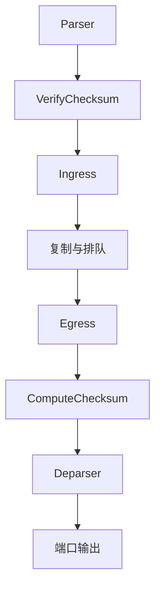

# 11 · V1Model 架构详解

本章依据 [p4c 的 `v1model.p4`](https://github.com/p4lang/p4c/blob/8b6de3c579e717ee278c38041b868e9ef2345f5f/p4include/v1model.p4) 和 [BMv2 `simple_switch` 文档](https://github.com/p4lang/behavioral-model/blob/2bdd0b7b2b2ae89faf2720f2158e9842bc6d2dd2/docs/simple_switch.md)，说明处理块接口、标准元数据及特殊报文路径。本机验证使用 p4c 1.2.5.10 和 `simple_switch` 1.15.0。

下文摘录的接口声明用于对照参数，程序通过 `#include <v1model.p4>` 引入这些定义。涉及 `hdr`、`meta`、`sm` 的片段采用 11.7 节的命名，额外类型会在相应位置说明。

## 11.1 V1Model 概览

V1Model 是 BMv2 `simple_switch` 使用的架构。普通单播报文的处理顺序可概括为：



图中展示普通单播的转发路径。解析和校验和检查的结果通过错误状态传给 Ingress，由程序决定继续处理还是丢弃。原报文在 Ingress 被丢弃后不再进入 Egress，克隆、重提交、重循环等请求的处理顺序见 11.5 节。

| 可编程块        | 主要职责                                 |
| --------------- | ---------------------------------------- |
| Parser          | 提取报头、产生解析错误                   |
| VerifyChecksum  | 验证指定数据的校验和                     |
| Ingress         | 查表、修改报头、选择单播或多播等处理方式 |
| Egress          | 按已选定的出端口和报文副本执行处理       |
| ComputeChecksum | 更新输出所需的校验和                     |
| Deparser        | 按程序顺序输出有效报头                   |

复制、排队和调度由目标实现。P4 程序通过元数据选择相应行为，控制平面则配置复制规则、队列深度和速率。

## 11.2 顶层 Package

`V1Switch` 接收六个处理块：

```p4
package V1Switch<H, M>(Parser<H, M> p,
                      VerifyChecksum<H, M> vr,
                      Ingress<H, M> ig,
                      Egress<H, M> eg,
                      ComputeChecksum<H, M> ck,
                      Deparser<H> dep);
```

它们都没有默认值或 `@optional` 标记，装配时必须全部提供：

```p4
V1Switch(MyParser(), MyVerifyChecksum(), MyIngress(), MyEgress(),
         MyComputeChecksum(), MyDeparser()) main;
```

不需要某个 Control 执行操作时，可以提供接口匹配、`apply` 为空的实现。构造调用在编译期完成装配，运行时由目标按架构规定调用各处理块，见 [第 10 章](./10-架构与包.md)。

## 11.3 六个块的接口

### 11.3.1 Parser

```p4
parser Parser<H, M>(packet_in packet, out H hdr,
                    inout M meta, inout standard_metadata_t sm);
```

`packet` 提供输入字节，`hdr` 接收解析得到的报头。报头的初始有效性、字段初始化和提取规则见 [第 6 章](./06-Parser解析器.md)。

用户元数据 `meta` 与标准元数据 `sm` 都是 `inout` 参数。重提交和重循环保留的用户元数据也通过 `meta` 传入，初始化时应区分首次处理与再次处理，保留后续仍要使用的值。

### 11.3.2 VerifyChecksum

```p4
control VerifyChecksum<H, M>(inout H hdr, inout M meta);
```

这里调用 `verify_checksum` 或 `verify_checksum_with_payload`。验证失败时，目标将错误记录在 `sm.checksum_error`，由 Ingress 读取并决定如何处理。该块本身没有独立的标准元数据参数。

### 11.3.3 Ingress

```p4
control Ingress<H, M>(inout H hdr, inout M meta,
                      inout standard_metadata_t sm);
```

Ingress 通常先检查解析和校验和结果，再查表并选择去向。普通单播使用 `sm.egress_spec`，多播使用 `sm.mcast_grp`。本机 `simple_switch` 在普通入站路径中将 `egress_spec` 初始化为 0，程序应明确选择出端口，或调用 `mark_to_drop` 标记丢弃。

### 11.3.4 Egress

```p4
control Egress<H, M>(inout H hdr, inout M meta,
                     inout standard_metadata_t sm);
```

报文到达 Egress 时，出端口已经确定，可从 `sm.egress_port` 读取。多播和克隆产生的副本分别执行 Egress，适合按端口改写报头或区分副本。

在 Egress 中把 `egress_spec` 改成另一个普通端口值，不会重新选路，报文仍发往本次 Egress 的既定端口。将该字段设为目标的丢包值，则会丢弃当前副本。

### 11.3.5 ComputeChecksum

```p4
control ComputeChecksum<H, M>(inout H hdr, inout M meta);
```

这里调用 `update_checksum` 或 `update_checksum_with_payload`。它位于 Egress 之后、报头输出之前，因而能覆盖 Egress 对参与计算字段的修改。函数的第一个参数控制是否计算，该块的语句限制见 11.8 节。

### 11.3.6 Deparser

```p4
control Deparser<H>(packet_out packet, in H hdr);
```

`hdr` 为 `in` 参数，不能在这里修改报头。BMv2 要求使用顺序的 `emit` 调用，未解析负载由目标保留。

接口没有独立的用户元数据参数。需要把元数据传入报文时，应在前面的处理块中将选定值写入有效且已初始化的报头，再输出该报头，见 [9.9 节](./09-Deparser反解析器.md#99-哪些数据会出现在输出中)。

## 11.4 `standard_metadata_t` 速查

以下为本机头文件提供的字段。表中的“只读”是架构对字段的使用约定，程序应按此约定访问。整个结构体的参数方向仍是 `inout`，字段的访问规则还需结合其含义和有效阶段判断。

| 字段                       | 类型/位宽 | 含义与使用位置                                             |
| -------------------------- | ---------- | ---------------------------------------------------------- |
| `ingress_port`             | `bit<9>`   | 普通入站报文的入端口，只读，特殊路径中的值见 11.8 节       |
| `egress_spec`              | `bit<9>`   | Ingress 选择单播端口，Ingress/Egress 均可用丢包值标记丢弃 |
| `egress_port`              | `bit<9>`   | 本次 Egress 的出端口，只读，由目标在 Egress 开始前设置     |
| `instance_type`            | `bit<32>`  | 当前处理阶段的实例类型，只读，见 11.6 节                   |
| `packet_length`            | `bit<32>`  | 当前报文实例的长度，单位为字节，只读                       |
| `enq_timestamp`            | `bit<32>`  | 入队时间戳，Egress 读取                                    |
| `enq_qdepth`               | `bit<19>`  | 入队时的队列深度，单位为报文数，Egress 读取                |
| `deq_timedelta`            | `bit<32>`  | 排队时间，Egress 读取                                      |
| `deq_qdepth`               | `bit<19>`  | 出队时的队列深度，单位为报文数，Egress 读取                |
| `ingress_global_timestamp` | `bit<48>`  | 入站时间戳，只读                                           |
| `egress_global_timestamp`  | `bit<48>`  | 开始 Egress 处理的时间戳，Egress 读取                      |
| `mcast_grp`                | `bit<16>`  | Ingress 指定多播组，0 表示不请求多播                       |
| `egress_rid`               | `bit<16>`  | 多播复制节点的 replication ID，Egress 读取                 |
| `checksum_error`           | `bit<1>`   | 校验和验证失败时为 1，Ingress 读取                         |
| `parser_error`             | `error`    | Parser 的错误结果，无错误时为 `error.NoError`              |
| `priority`                 | `bit<3>`   | 入队时选择优先级队列                                       |

队列和时间戳字段通过头文件中的 `@alias` 对应到 BMv2 内部字段，程序通过 `v1model.p4` 使用这组映射。

本机头文件默认使用 `V1MODEL_VERSION=20180101`。设置为 `20200408` 或更大值时，三个端口字段改用 `PortId_t`，它在本机定义中是 `bit<9>` 的别名。版本宏还会影响部分 extern 接口，相关声明需与头文件版本配套使用。

### 11.4.1 长度、时间戳与队列

普通入站报文的 `packet_length` 记录交给 BMv2 的报文字节数，是否包含 Ethernet FCS 由收发路径决定。最终输出长度还取决于报头的有效性和 Deparser 的输出，修改报头或协议长度字段时，需将输入长度与实际输出字节数分开核对。

本机时间戳和排队时长以微秒计，全局时间戳以进程启动附近的时间为基准，定宽字段达到上限后回绕。队列深度以报文数计。

`simple_switch` 默认每个端口只有一个优先级队列。使用多个队列时，启动参数形如 `--priority-queues 3`，放在目标参数分隔符 `--` 之后。此时合法优先级为 0、1、2，数值越大优先级越高。本机在入队时检查 `priority`，超出已配置队列范围的报文会被丢弃。

### 11.4.2 出端口、多播与丢弃

丢包端口默认是 511，可以通过 `--drop-port` 修改。程序宜调用 `mark_to_drop(sm)`，避免把 511 固定写入通用逻辑。

`mcast_grp` 为非零值时，目标查找控制平面配置的多播组，按组内复制节点产生副本。没有有效复制节点时，不产生输出。`egress_rid` 取自复制节点的 RID 配置，同一个节点发往多个端口时，这些副本使用相同的 RID。

## 11.5 常用 extern 函数

### 11.5.1 `mark_to_drop`

```p4
extern void mark_to_drop(inout standard_metadata_t standard_metadata);
```

该调用将 `egress_spec` 设为目标的丢包值，并清零 `mcast_grp`，随后继续执行代码。后续赋值仍可能改变报文去向。要停止当前控制调用链，可在调用后执行 `exit`，见 [7.7 节](./07-控制块与动作.md#77-noaction-与-mark_to_drop)。

与克隆、重提交等请求同时出现时，各请求按 11.5.8 节的顺序处理。

### 11.5.2 校验和验证与更新

两个接口的第三个参数方向不同：

```p4
extern void verify_checksum<T, O>(in bool condition, in T data,
                                  in O checksum, HashAlgorithm algo);
extern void update_checksum<T, O>(in bool condition, in T data,
                                  inout O checksum, HashAlgorithm algo);
```

`verify_checksum` 读取报头中已有的校验和值，通过架构错误状态报告结果。`update_checksum` 将计算结果写回。条件为 `false` 时，前者跳过本次验证并保留已有错误状态，后者保留输出字段的原值。

按接口约束，`data` 是由 `bit<W>`、`int<W>` 或 `varbit<W>` 字段组成的元组，总位宽须为校验和值位宽的整数倍，校验和字段为 `bit<X>`。算法参数须为编译期常量，算法与位宽的组合须符合目标支持范围。

IPv4 固定报头使用 `csum16`，参与计算的数据按报头顺序排列，并排除原 `hdrChecksum` 字段，完整代码见 11.7 节。IHL 大于 5 时，还需将选项纳入计算。

带 `_with_payload` 后缀的接口会再纳入 Parser 未解析的字节，其覆盖范围由 Parser 消耗的字节数决定。计算 TCP/UDP 校验和时，需要安排伪首部和传输层字段，并核对未解析部分是否包含协议长度以外的填充。

### 11.5.3 `hash`

```p4
extern void hash<O, T, D, M>(out O result, in HashAlgorithm algo,
                             in T base, in D data, in M max);
```

下面片段可放在 Ingress 的 `apply` 中，调用前应确保 Ethernet 报头有效：

```p4
bit<32> bucket;
hash(bucket, HashAlgorithm.crc32, 32w0,
     { hdr.ethernet.src, hdr.ethernet.dst }, 32w8);
```

结果落在 0 到 7 之间。一般而言，`max >= 1` 时结果范围为 `[base, base + max - 1]`，`max == 0` 时结果为 `base`。应选择足以容纳结果的位宽，并保证参与计算的字段已初始化。

### 11.5.4 `random`

```p4
extern void random<T>(out T result, in T lo, in T hi);
```

`T` 为 `bit<W>`，结果取自包含两个端点的区间 `[lo, hi]`，调用时应保证 `lo <= hi`。本机实现支持的位宽为 1 到 64 位。

### 11.5.5 `clone` 与元数据保留

```p4
extern void clone(in CloneType type, in bit<32> session);
extern void clone_preserving_field_list(in CloneType type,
                                        in bit<32> session, bit<8> index);
```

`session` 是镜像会话标识，需由控制平面预先配置。例如，在已绑定端口 3 的实验中，向 `simple_switch_CLI` 输入以下命令，将会话 100 的副本发往端口 3：

```text
mirroring_add 100 3
```

P4 程序再在 Ingress 调用 `clone(CloneType.I2E, 100)`。镜像会话也可以通过 `mirroring_add_mc` 关联一个已用 `mc_*` 命令配置好的多播组。

| 操作            | 调用位置 | 副本起点与报头内容                                                             |
| --------------- | -------- | ------------------------------------------------------------------------------ |
| `CloneType.I2E` | Ingress  | 使用本轮 Parser 开始时的报文字节，BMv2 重新解析后进入 Egress，跳过用户 Ingress |
| `CloneType.E2E` | Egress   | 使用该次 Egress 结束时的报头状态，再执行一次 Egress                            |

原报文继续按自己的路径处理，未配置镜像会话时不产生对应副本。同一次 Ingress 或 Egress 执行中多次调用克隆接口，以最后一次请求的会话和字段列表为准。

`clone` 不保留用户元数据。需要保留字段时，把 `@field_list` 标在用户元数据的字段上，例如用下面的类型替换程序中的 `metadata` 声明：

```p4
struct metadata {
    @field_list(1)
    bit<9> original_port;
}
```

Ingress 可先设置 `meta.original_port = sm.ingress_port`，再调用 `clone_preserving_field_list(CloneType.I2E, 100, 1)`。I2E 保留该次 Ingress 结束时的字段值，E2E 保留该次 Egress 结束时的字段值。需要随副本携带的用户元数据字段都应标记到相应列表中。

E2E 副本会再次执行 Egress，应根据 `instance_type` 等条件避免无界克隆。

### 11.5.6 `digest`

```p4
extern void digest<T>(in bit<32> receiver, in T data);
```

`digest` 在 Ingress 向控制平面报告选定字段。接口规定数据取调用时的值，与克隆保留元数据的取值时机不同。消息可以批量处理，接收和确认方式取决于所用控制接口。

BMv2 的 V1Model 实现忽略 `receiver` 参数的数值。使用命名结构体作为 `T`，可为控制平面接口提供明确的类型名称。

### 11.5.7 重提交与重循环

当前接口使用字段列表索引：

```p4
extern void resubmit_preserving_field_list(bit<8> index);
extern void recirculate_preserving_field_list(bit<8> index);
```

| 操作                                | 调用位置 | 再次进入 Parser 的字节                                    |
| ----------------------------------- | -------- | --------------------------------------------------------- |
| `resubmit_preserving_field_list`    | Ingress  | 本轮解析开始时的原报文字节，丢弃本轮 Ingress 对报头的修改 |
| `recirculate_preserving_field_list` | Egress   | 经本轮校验和更新和 Deparser 输出后的报文字节              |

调用这两个接口会记录请求，分别在 Ingress 或 Egress 结束时转入后续路径。`index` 为编译期确定的 `bit<8>` 值，选择用户元数据中标记为 `@field_list(index)` 的字段，保留值分别取自 Ingress 或 Egress 结束时。

本机头文件将旧的 `resubmit<T>(data)`、`recirculate<T>(data)` 标为弃用，示例采用上面的字段列表接口。两种路径都在目标内部将报文交回 Parser。

程序必须设置终止条件，例如检查进入 Ingress 时的实例类型，或使用保留的计数元数据限制次数。Parser 的初始化不能再无条件清掉这个计数。

### 11.5.8 多种请求同时出现时

本机 `simple_switch` 在 Ingress 结束时先处理克隆和学习请求，再按以下顺序选择原报文的去向：

1. 已请求重提交：返回 Parser。
2. 否则，`mcast_grp != 0`：按多播组复制。
3. 否则，`egress_spec` 为丢包值：丢弃。
4. 否则：向 `egress_spec` 指定的端口入队。

Egress 结束时先处理克隆，再判断原副本是否丢弃。未丢弃且请求重循环时，在反解析后返回 Parser，否则从既定端口输出。因此，丢弃原报文时仍可产生已请求的镜像副本，Ingress 中的重提交请求也会先于丢弃判断得到处理。

详细顺序见 [BMv2 的处理伪代码](https://github.com/p4lang/behavioral-model/blob/2bdd0b7b2b2ae89faf2720f2158e9842bc6d2dd2/docs/simple_switch.md#pseudocode-for-what-happens-at-the-end-of-ingress-and-egress-processing)。

## 11.6 `instance_type` 的取值与阶段

下表对应本机 [`SimpleSwitch::PktInstanceType`](https://github.com/p4lang/behavioral-model/blob/2bdd0b7b2b2ae89faf2720f2158e9842bc6d2dd2/targets/simple_switch/simple_switch.h)：

| 值  | 名称            | 主要含义                                           |
| --- | --------------- | -------------------------------------------------- |
| 0   | `NORMAL`        | 从端口进入的普通报文，也用于普通单播的 Egress 处理 |
| 1   | `INGRESS_CLONE` | I2E 克隆副本进入 Egress                            |
| 2   | `EGRESS_CLONE`  | E2E 克隆副本进入 Egress                            |
| 3   | `COALESCED`     | 源码中定义的枚举值，本章所述路径不使用             |
| 4   | `RECIRC`        | 重循环报文再次进入 Parser/Ingress                 |
| 5   | `REPLICATION`   | Ingress 多播复制后的 Egress 副本                   |
| 6   | `RESUBMIT`      | 重提交报文再次进入 Parser/Ingress                 |

这些名称来自目标的 C++ 枚举。P4 程序需要比较实例类型时，应按表中的数值声明所用常量。

`instance_type` 随处理阶段变化。本机实验中，值为 4 或 6 的报文再次完成 Ingress、选择普通单播后，进入 Egress 时变为 0。若 Egress 还需要知道此前经历过重提交或重循环，应在 Ingress 将该信息写入用户元数据。

## 11.7 完整示例：固定 IPv4 路由实验

下面程序可保存为 `v1model-demo.p4`。它只接收无 VLAN、IHL 为 5 的 IPv4 报文，检查长度、解析错误、校验和和 TTL，再查一条固定路由：目的地址属于 `10.0.2.0/24` 时，从端口 2 输出，并改写两端 MAC、递减 TTL、更新 IPv4 校验和。

```p4
#include <core.p4>
#include <v1model.p4>

error { BadIPv4Version, UnsupportedIPv4Options, BadIPv4Length }

header ethernet_t {
    bit<48> dst;
    bit<48> src;
    bit<16> etherType;
}
header ipv4_t {
    bit<4> version;
    bit<4> ihl;
    bit<8> diffserv;
    bit<16> totalLen;
    bit<16> identification;
    bit<3> flags;
    bit<13> fragOffset;
    bit<8> ttl;
    bit<8> protocol;
    bit<16> hdrChecksum;
    bit<32> src;
    bit<32> dst;
}
struct headers {
    ethernet_t ethernet;
    ipv4_t ipv4;
}
struct metadata { }

parser MyParser(packet_in packet, out headers hdr,
                inout metadata meta, inout standard_metadata_t sm) {
    state start {
        packet.extract(hdr.ethernet);
        transition select(hdr.ethernet.etherType) {
            0x0800: parse_ipv4;
            default: accept;
        }
    }
    state parse_ipv4 {
        packet.extract(hdr.ipv4);
        verify(hdr.ipv4.version == 4, error.BadIPv4Version);
        verify(hdr.ipv4.ihl == 5, error.UnsupportedIPv4Options);
        verify(hdr.ipv4.totalLen >= 20, error.BadIPv4Length);
        verify((bit<32>)hdr.ipv4.totalLen <= sm.packet_length - 14,
               error.BadIPv4Length);
        transition accept;
    }
}
control MyVerifyChecksum(inout headers hdr, inout metadata meta) {
    apply {
        verify_checksum(
            hdr.ipv4.isValid() && hdr.ipv4.ihl == 5,
            { hdr.ipv4.version, hdr.ipv4.ihl, hdr.ipv4.diffserv,
              hdr.ipv4.totalLen, hdr.ipv4.identification,
              hdr.ipv4.flags, hdr.ipv4.fragOffset,
              hdr.ipv4.ttl, hdr.ipv4.protocol,
              hdr.ipv4.src, hdr.ipv4.dst },
            hdr.ipv4.hdrChecksum, HashAlgorithm.csum16);
    }
}
control MyIngress(inout headers hdr, inout metadata meta,
                  inout standard_metadata_t sm) {
    action drop() {
        mark_to_drop(sm);
    }
    action forward(bit<48> dst_mac, bit<48> src_mac, bit<9> port) {
        hdr.ethernet.dst = dst_mac;
        hdr.ethernet.src = src_mac;
        hdr.ipv4.ttl = hdr.ipv4.ttl - 1;
        sm.egress_spec = port;
    }
    table ipv4_lpm {
        key = { hdr.ipv4.dst: lpm; }
        actions = { forward; drop; }
        const default_action = drop();
        const entries = {
            0x0a000200 &&& 0xffffff00: forward(0x020000000202, 0x020000000201, 2);
        }
    }
    apply {
        if (sm.parser_error != error.NoError || sm.checksum_error == 1) {
            drop();
            exit;
        }
        if (!hdr.ipv4.isValid()) {
            drop();
            exit;
        }
        if (hdr.ipv4.ttl <= 1) {
            drop();
            exit;
        }
        ipv4_lpm.apply();
    }
}
control MyEgress(inout headers hdr, inout metadata meta,
                 inout standard_metadata_t sm) {
    apply { }
}
control MyComputeChecksum(inout headers hdr, inout metadata meta) {
    apply {
        update_checksum(
            hdr.ipv4.isValid() && hdr.ipv4.ihl == 5,
            { hdr.ipv4.version, hdr.ipv4.ihl, hdr.ipv4.diffserv,
              hdr.ipv4.totalLen, hdr.ipv4.identification,
              hdr.ipv4.flags, hdr.ipv4.fragOffset,
              hdr.ipv4.ttl, hdr.ipv4.protocol,
              hdr.ipv4.src, hdr.ipv4.dst },
            hdr.ipv4.hdrChecksum, HashAlgorithm.csum16);
    }
}
control MyDeparser(packet_out packet, in headers hdr) {
    apply {
        packet.emit(hdr.ethernet);
        packet.emit(hdr.ipv4);
    }
}

V1Switch(MyParser(), MyVerifyChecksum(), MyIngress(), MyEgress(),
         MyComputeChecksum(), MyDeparser()) main;
```

编译命令：

```bash
p4test --std p4-16 v1model-demo.p4
p4c-bm2-ss --std p4-16 --arch v1model -o v1model-demo.json v1model-demo.p4
```

绑定输入端口与端口 2 后即可测试，`const entries` 中的路由已随程序加载。P4 源码使用 `&&&` 掩码表达前缀，本例的 `0x0a000200 &&& 0xffffff00` 对应 `10.0.2.0/24`。

需要运行双向路由实验时，可使用仓库的 [IPv4 路由示例](../examples/03-ipv4-router/README.md)。其脚本编译示例目录中的 `router.p4`，再通过 Thrift 分别配置路由、下一跳 MAC 和出端口 MAC，命令及参数以该示例的 README 为准。

| 输入条件                                            | 预期结果                                     |
| --------------------------------------------------- | -------------------------------------------- |
| 有效报文、TTL 大于 1、命中固定前缀                  | 输出端口 2，TTL 减 1，MAC 与 IPv4 校验和更新 |
| Ethernet/IPv4 被截断，或 IPv4 版本、长度不符合检查 | 丢弃                                         |
| IPv4 校验和错误                                     | 丢弃                                         |
| TTL 为 0 或 1                                       | 丢弃                                         |
| 路由未命中、非 IPv4、VLAN 或 IPv4 选项              | 丢弃                                         |

示例使用静态 MAC 地址和固定路由，实验时应按拓扑配置端口。BMv2 保留未解析部分，实际输入中位于 IPv4 数据报之后的 Ethernet 填充也会随报文输出。

本机已逐字节验证正常转发、TTL 边界、错误校验和、截断、长度不一致、路由未命中及填充保留等情况。修改 TTL 不影响 TCP/UDP 伪首部，因此本例只需更新 IPv4 报头校验和。

## 11.8 架构与实现边界

| 项目                 | 应如何理解                                                                                           |
| -------------------- | ---------------------------------------------------------------------------------------------------- |
| 六个顶层块           | Package 接口固定，Ingress/Egress 内可组织子 Control 和多张表                                        |
| 校验和位宽           | 接口为 `bit<X>`，本机已验证 `bit<32>` 配合 `crc32`                                                   |
| 端口号               | 本机元数据为 9 位，可编码 0–511，可用输出端口取决于丢包值和接口绑定配置。本机文件端口 300 已验证可用 |
| Parser 长度接口      | 本机后端不支持 `packet_in.length()`，11.7 节使用普通入站路径的 `sm.packet_length`                    |
| 校验和与 Deparser 块 | 校验和块仅支持对应的校验和调用、块语句和 `return`，Deparser 使用顺序的 `emit` 调用                   |
| 性能与资源           | BMv2 用于软件功能验证，迁移到硬件时另行核对流水线阶段、存储资源和吞吐量                              |

需要跨克隆、重提交或重循环保存原始入端口等信息时，应在首次 Ingress 中将其写入用户元数据，并用 `@field_list` 标记。本机重提交和重循环路径会重置标准元数据，`ingress_port` 在再次进入 Parser 时为 0，原始物理入端口应从保留的用户元数据读取。

## 11.9 本章小结

使用 V1Model 时，要结合接口方向、元数据的有效阶段和报文路径安排处理逻辑。先处理解析与校验和错误，再安排转发和特殊请求。克隆、重提交和重循环的字节来源、元数据保留时机各有区别，实验时应同时核对实际输出端口、报头内容和副本数量。

## 11.10 下一步

[第 12 章](./12-外部对象Extern.md)进一步讨论计数器、计量器、寄存器等 extern 的接口、状态与并发语义。
